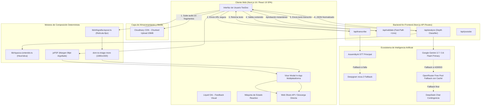
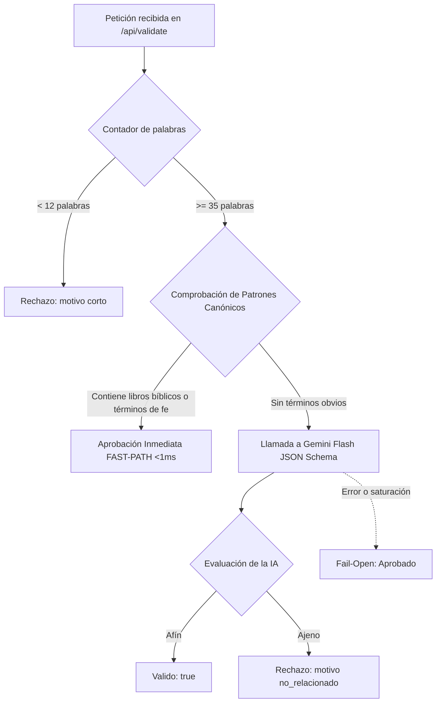

# MANUAL TÉCNICO Y ARQUITECTURA DE SISTEMA — TEODOC
**Documento Oficial de Arquitectura, Metodologías y Flujos Operativos**  
**Proyecto:** TeoDoc — Analizador Ministerial (`analizador-ministerial` / `rpmministry/teodoc-app`)  
**Versión del Sistema:** 2.1.0 (Producción — Septiembre 2026)  
**Framework:** Next.js 16.3.3 (Turbopack, App Router) + React 19.2.8 + TypeScript 5  
**Diseño:** IBM Carbon Design System + Estándares Impeccable  

---

## 1. INTRODUCCIÓN Y VISIÓN DEL PRODUCTO

### 1.1 Misión de TeoDoc
**TeoDoc** es una plataforma de software diseñada para asistir a pastores, teólogos, expositores bíblicos y ministerios en la estructuración pedagógica y conservación de mensajes, conferencias y enseñanzas orales. Su propósito no es sustituir la labor homilética ni generar predicaciones sintéticas, sino actuar como un **asistente de estudio analítico de alta fidelidad**: escucha la enseñanza impartida, transcribe con precisión el mensaje, analiza su estructura doctrinal según el canon bíblico tradicional (Reina-Valera 1960) y sintetiza el contenido en formatos editoriales de estándar internacional.

### 1.2 Artefactos Generados por el Sistema
Por cada mensaje procesado, TeoDoc produce de manera determinista:
1. **Estudio Expositivo Completo:** Documento analítico con idea central, contexto histórico y literario, desarrollo de puntos con pasajes citados, conceptos teológicos, aplicaciones prácticas y oración ministerial.
2. **Documento Editorial PDF A4:** Documento maquetado con especificación estricta de encuadernación y anillado de libros (**margen izquierdo seguro de argollado de 98 pt / ~35 mm**).
3. **Infografía Editorial 9:16 (1080×1920 px):** Pieza gráfica de una sola lámina vertical continua lista para difusión en dispositivos móviles y redes sociales (WhatsApp Stories, Instagram, Telegram), con versiones en Tema Oscuro y Tema Claro.

---

## 2. ARQUITECTURA GLOBAL Y FLUJO DE DATOS END-TO-END

El sistema se basa en un patrón **Backend-for-Frontend (BFF)** con orquestación reactiva en el cliente y resiliencia multi-nivel bajo una filosofía de **costo cero con degradación elegante**.

### 2.1 Diagrama de Arquitectura General



---

## 3. PIPELINE DE INGESTA MULTIMEDIA Y TRANSCRIPCIÓN (STT)

### 3.1 Subida Fragmentada (*Chunked Upload*)
Para evitar la saturación de memoria en dispositivos móviles (WebKit / Safari en iOS) y prevenir caídas de conexión en archivos pesados (hasta 500 MB):
- El cliente divide el archivo de audio localmente en fragmentos continuos de **20 MB** (`file.slice(start, end)`).
- Cada fragmento se envía mediante una petición HTTP `POST` independiente hacia la API de Cloudinary acompañada de cabeceras `Content-Range` e identificador de sesión único (`X-Unique-Upload-Id`).
- La memoria no acumula el archivo entero en el hilo de ejecución, permitiendo que sermones en WAV o grabaciones largas de 2 horas se carguen de manera fluida y tolerante a fallos de red.

### 3.2 Conmutación por Error en Transcripción
El endpoint `/api/transcribe` implementa una estrategia de alta disponibilidad:
1. **Proveedor Primario (AssemblyAI SDK):** Procesa el audio referenciado por la URL segura de Cloudinary con `language_code: 'es'`.
2. **Proveedor de Contingencia (Deepgram REST API):** Si AssemblyAI arroja error de cuota o servicio no disponible, el backend conmuta de forma transparente a Deepgram utilizando el modelo `nova-2` con `smart_format=true`.
3. **Resultado:** Se extrae una transcripción limpia y puntuada en español sin interrumpir al usuario.

---

## 4. FAST-PATH HEURÍSTICO DE VALIDACIÓN Y PROTECCIÓN

En la versión 2.1 se introdujo un algoritmo de validación de doble vía en `/api/validate`:



### 4.1 Reglas del Fast-Path
- **Registro Canónico (`LIBROS_BIBLICOS`):** Lista compilada de los 66 libros del canon de la Escritura en español (`Génesis|Éxodo|...|Apocalipsis`).
- **Vocabulario Doctrinal:** Detección de términos clave como `Dios`, `Jesús`, `Cristo`, `Señor`, `Espíritu Santo`, `Evangelio`, `Salvación`, `Gracia`, `Fe`, etc.
- **Ahorro Comprobado:** **2.0 a 4.0 segundos por análisis**, reduciendo a cero el consumo de cuota de IA en la fase previa.

---

## 5. MOTOR DE ANÁLISIS TEOLÓGICO Y CADENA DE RESILIENCIA LLM

El análisis profundo se gobierna en `/api/analyze/route.ts` y se apoya en una arquitectura de tres niveles con normalización forzada.

### 5.1 Cadena de Contingencia Multi-Tier

| Nivel | Motor / Proveedor | Configuración Técnica | Timeout | Objetivo |
| :---: | :--- | :--- | :---: | :--- |
| **Tier 1 (Principal)** | Google Gemini 3.7 / 3.6 Flash | SDK `@google/genai` con `responseSchema` estricto y salida JSON estructurada. | 40 s | Máxima velocidad, contexto amplio de 1 millón de tokens y costo cero. |
| **Tier 2 (Respaldo)** | OpenRouter Free Pool | Modelos gratuitos `:free` (`gemini-2.0-flash-exp`, `qwen-2.5-72b`) con caché de catálogo de 30 min. | 120 s | Absorber picos de saturación del proveedor primario. |
| **Tier 3 (Contingencia)** | DeepSeek API (`deepseek-chat`) | Llamada REST con `response_format: { type: 'json_object' }` y 8,000 tokens máximos. | 110 s | Salvaguarda final de pago si todos los proveedores gratuitos fallan. |

### 5.2 Clasificador de Riqueza Homilética (`lib/riqueza-contenido.ts`)
Antes de invocar al modelo de lenguaje, una función pura analiza la densidad textual:
- **Tasa Homilética:** $\approx 130 \text{ palabras por minuto}$ (estándar hispanohablante).
- **Niveles de Profundidad:**
  - `breve`: $<1,800$ palabras o $<14$ min $\implies$ 2 a 3 puntos principales.
  - `media`: $1,800 - 4,500$ palabras $\implies$ 3 a 6 puntos principales.
  - `amplia`: $4,500 - 9,000$ palabras $\implies$ 5 a 9 puntos principales.
  - `profunda`: $>9,000$ palabras o conferencias densas $\implies$ 7 a 12 puntos principales.
- **Factor de Corrección Bíblica:** Si un mensaje medio contiene $\ge 15$ citas explícitas, asciende de nivel para capturar su densidad doctrinal sin inflar artificialmente el texto.

### 5.3 Normalización Defensiva
Para garantizar que ni el generador de PDFs ni el lienzo de la infografía fallen por respuestas incompletas o campos vacíos devueltos por el LLM:
- Todos los campos se sanean con `normalizarAnalisis(jsonResult)`.
- Si faltan `grandes_ensenanzas` en la infografía, se derivan automáticamente del primer enunciado de cada punto de desarrollo.
- Si no hay `conceptos_clave`, se extraen las palabras doctrinales más frecuentes excluyendo palabras vacías (*stop words*).

---

## 6. MOTOR DE COMPOSICIÓN EDITORIAL DE LA INFOGRAFÍA 9:16

Diseñado en `lib/infografia-layout.ts` y renderizado en `components/infografia.tsx`.

### 6.1 Dimensiones y Retícula Carbon
- **Lienzo Absoluto:** $1080 \times 1920 \text{ px}$ (proporción matemática exacta 9:16).
- **Retícula Base:** Unidad elemental de 8 px inspirada en IBM Carbon Design System.
- **Safe Zones:**
  - `SAFE_TOP = 64 px` (protección de cabecera de Stories / WhatsApp).
  - `SAFE_BOTTOM = 64 px` (protección de barra de respuestas y controles).
  - `SAFE_LATERAL = 48 px` (ancho útil de 984 px).
- **Pisos de Legibilidad:**
  - Display / Título: $\ge 48 \text{ px}$
  - Numerales de Puntos: $\ge 32 \text{ px}$
  - Subtítulos de Bloque: $\ge 20 \text{ px}$
  - Cuerpo de Texto: $\ge 16 \text{ px}$
  - Insignias / Captions: $\ge 12 \text{ px}$

### 6.2 Arquetipos Editoriales Dinámicos
La infografía adapta su estructura según el número de puntos reales:
1. **Arquetipo Breve ($\le 3$ puntos):** 1 columna amplia con ilustración temática centralizada (*Hero*).
2. **Arquetipo Medio (4 a 5 puntos):** Cuadrícula balanceada de 2 columnas con versículos de apoyo secundarios.
3. **Arquetipo Extenso (6 a 10 puntos):** Composición modular continua de alta densidad tipográfica con insignias de doctrina.

### 6.3 Rasterización Safari-Safe
Para exportar a PNG sin dependencias de red en WebKit:
- **Cero Recursos Remotos:** Todas las fuentes y las 13 ilustraciones temáticas vectoriales están embebidas como SVG inline en el paquete.
- **Exportación con `dom-to-image-more`:** Se clona el artboard con transformaciones de escala precisas garantizando un archivo PNG genuino (`image/png`) con resolución real de 1080×1920 px.

---

## 7. MOTOR DE GENERACIÓN VECTORIAL DE PDF Y ESPECIFICACIÓN DE ENCUADERNACIÓN

Implementado programáticamente mediante `jsPDF` en `app/page.tsx` (`construirPDFBlob`).

### 7.1 Geometría del Documento A4 y Margen de Argollado

```
+-------------------------------------------------------------+  ^
|  Banda Azul Superior (6 pt) Carbon Accent                   |  |
|                                                             |  | marginT = 60 pt
|                  ESTUDIO BÍBLICO EXPOSITIVO                 |  v
|                                                             |
|<--- margin = 98 pt --->|<----- contentW = 443 pt ------>|<-- marginR = 54 pt -->|
|                        |                                |
|  ZONA SEGURA           |  TÍTULO DEL MENSAJE            |
|  DE ARGOLLADO          |  (Línea de acento + Helvetica) |
|  Y ENCUADERNACIÓN      |                                |
|  (~35 mm para espiral  |  “Idea Central del Expositor”  |
|  o perforación de      |                                |
|  carpetas ministeriales|  01. Título del Punto          |
|  sin perforar texto)   |      Desarrollo y versículos   |
|                        |                                |
|                        |  APLICACIÓN PRÁCTICA           |
|                        |  ORACIÓN FINAL                 |
|                                                             |  ^
|  TeoDoc Ministerial · Página 1 de 4                         |  | marginB = 64 pt
+-------------------------------------------------------------+  v
```

- **Margen Interior Izquierdo:** `98 pt` ($\approx 34.6 \text{ mm}$). Protege el texto contra perforadoras de 2 y 3 orificios o espirales metálicos.
- **Margen Exterior Derecho:** `54 pt` ($\approx 19 \text{ mm}$).
- **Regla Anti-Huérfanos (*Keep-with-next*):** Antes de imprimir un título de sección, el motor calcula `ensure(headerH + keep)`. Si el espacio restante no permite alojar el título y las primeras dos líneas del párrafo, salta de página automáticamente.

---

## 8. ARQUITECTURA DE ENTREGA IN-APP PARA SAFARI IOS Y ANDROID

### 8.1 Eliminación de la Pestaña en Blanco en iOS
En navegadores basados en WebKit (iOS Safari, iPadOS, Chrome iOS), la ejecución programática de un enlace `<a>` con `download` o `window.open(blobUrl, '_blank')` abre una pestaña en blanco permanente (`about:blank`) o bloquea la descarga.

**Metodología TeoDoc Adoptada:**
1. **Detección Certera de iOS/iPadOS:**
   ```typescript
   const esIOS = () => {
     const ua = navigator.userAgent || '';
     const plataforma = navigator.platform || '';
     const maxTouch = navigator.maxTouchPoints || 0;
     const iPadOS = plataforma === 'MacIntel' && maxTouch > 1;
     return /iPad|iPhone|iPod/.test(ua) || iPadOS;
   };
   ```
2. **Entrega No Invasiva:**
   - En Android y Escritorio: Se activa la descarga silenciosa con `<a download="...">` oculto.
   - En iOS: **No se navega la ventana actual ni se abren popups**. El archivo generado se carga en memoria en un visor modal in-app.
   - Desde el banner interactivo y el visor, el usuario puede pulsar **«Ver»**, **«Guardar / Compartir»** (vía Web Share API nativa con hoja de compartir de iOS) o descargar directamente.

---

## 9. CERTIFICACIÓN DE CALIDAD (QA) Y SUITE DE INVARIANTES

La aplicación cuenta con una suite automatizada de 40 pruebas en TypeScript ejecutable mediante `npm run verificar`:

```
======================================================================
                   MATRIZ DE CERTIFICACIÓN QA
======================================================================
[TEST:LOGICA] (11 pruebas)
  ✓ Clasificación de riqueza: breve, media, amplia y profunda
  ✓ Rangos de puntos sugeridos proporcionales
  ✓ Tolerancia ante entradas vacías
  ✓ Detección de libros bíblicos RV1960

[TEST:INFOGRAFIA] (9 pruebas)
  ✓ Canvas inmutable 1080×1920 (9:16)
  ✓ Retícula matemática basada en unidad de 8 px
  ✓ Safe zones de cabecera y pie
  ✓ Pisos de legibilidad tipográfica absoluta
  ✓ Activación precisa de arquetipos editorial breve, medio y extenso

[TEST:ENTREGA] (20 pruebas)
  ✓ Detección multiplataforma (iOS, iPadOS, Android, Desktop)
  ✓ Web Share API habilitada para archivos binarios
  ✓ No apertura de pestañas en blanco en Safari
  ✓ Tipo MIME estricto application/pdf e image/png
  ✓ Margen de argollado de 98 pt y control de huérfanos
  ✓ Ausencia total de recursos remotos en infografía
  ✓ Terminología: Prohibición de "prédica" y uso de "el expositor"
======================================================================
RESULTADO GLOBAL: 40/40 APROBADAS (100% ÉXITO)
======================================================================
```

---

## 10. CONCLUSIÓN

El diseño y la ingeniería de **TeoDoc** representan un equilibrio óptimo entre **resiliencia técnica**, **eficiencia en costos** y **artesanía visual**. Al integrar un pipeline de IA con failover automático, un fast-path de validación instantánea, maquetación matemática bajo IBM Carbon y un sistema de entrega in-app adaptado a los rigores de Safari iOS, la aplicación ofrece una experiencia de uso sólida, confiable y ministerialmente reverente.
